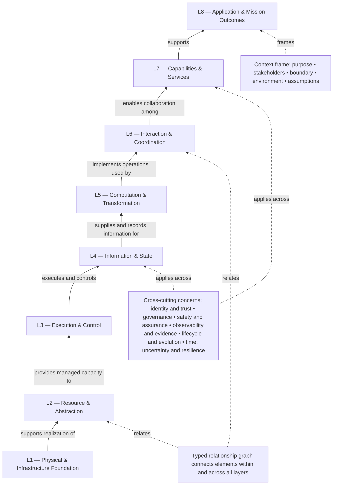

# DUSRM 0.3 — Proposed Universal Reference Structure

**Document ID:** DUSRM-ARCH-002  
**Status:** Candidate architecture; non-normative  
**Version:** 0.3-draft  
**Date:** 2026-11-09

## 1. Purpose

This document proposes a human-readable structural architecture for DUSRM. It aims to retain the usefulness of a layered reference model while avoiding the limitations of a single linear protocol stack.

The proposal is a **hybrid reference structure** comprising:
- a system context frame;
- eight responsibility layers;
- a typed relationship graph;
- cross-cutting concerns;
- multiple viewpoints.

The layers group architectural responsibilities. They are not required to map one-to-one to software modules, physical components, processes, teams, APIs, protocols, or deployed services.

## 2. System context frame

The context frame surrounds the full system description. It is not an additional layer.

It declares:
- system of interest and purpose;
- stakeholders, roles, and mission or application context;
- system boundary and scope;
- environment and external dependencies;
- assumptions, constraints, and relevant operating conditions;
- lifecycle phase and description status.

The context frame is essential because the same element may be internal or external depending on the chosen system boundary.

## 3. Candidate eight-layer responsibility stack

The reference ordering below proceeds from realization substrate toward application and mission outcomes.

**Interpretation warning:** The upward arrows show a conceptual support relationship, not a mandatory execution sequence, data-flow path, or one-way dependency rule. Real systems may contain feedback, peer interactions, and non-adjacent relationships. Those are represented explicitly in the relationship graph.

### L1 — Physical and Infrastructure Foundation

**Question:** On what substrate does the system exist or operate?

Responsibilities:
- physical devices, mechanical assemblies, power sources, sensors, actuators, and physical media;
- computing hardware and infrastructure hosting;
- facilities, deployment environment, and physical boundary conditions;
- physical realization constraints that affect system behavior.

Not responsible for:
- higher-level resource allocation policies;
- application intent;
- API or protocol semantics.

Examples include a robot chassis, motors, cameras, batteries, compute hardware, or the physical host supporting a software application.

### L2 — Resource and Abstraction

**Question:** What resources are available, how are they represented, and how are they allocated or controlled?

Responsibilities:
- compute, memory, storage, energy, bandwidth, workspace, and other resource capacities;
- resource abstractions and allocation boundaries;
- ownership, sharing, contention, limits, reservation, and release;
- mapping between abstract resource requirements and available substrate.

Not responsible for:
- defining the algorithm that consumes the resource;
- defining the physical construction of the substrate;
- application-level mission outcomes.

### L3 — Execution and Control

**Question:** How is behavior activated, progressed, scheduled, sequenced, coordinated locally, interrupted, or terminated?

Responsibilities:
- operation activation and execution occurrence;
- scheduling, sequencing, concurrency, dispatch, and synchronization within the declared scope;
- local control behavior and feedback mechanisms;
- execution status, interruption, cancellation, and termination semantics.

Not responsible for:
- the meaning of data;
- the business or mission purpose of an operation;
- a specific runtime, scheduler implementation, or motor-control protocol.

### L4 — Information and State

**Question:** What information and state does the system represent, own, maintain, observe, or exchange?

Responsibilities:
- information identity and semantics;
- state definitions, ownership, consistency requirements, and lifecycle;
- relationships between observations, derived information, and authoritative state;
- persistence and retention properties as requirements or responsibilities.

Not responsible for:
- a particular database engine;
- binary serialization or wire encoding;
- physical memory or storage implementation.

### L5 — Computation and Transformation

**Question:** What operations, algorithms, and transformations produce system results?

Responsibilities:
- computational operations and their semantics;
- transformations, evaluation, inference, analysis, and decision logic;
- dependencies between computational steps;
- preconditions, postconditions, and logical effects.

Not responsible for:
- the scheduling mechanism that executes an operation;
- the transport used to invoke a remote operation;
- the encoding of input or output bytes.

### L6 — Interaction and Coordination

**Question:** How do system elements or independent systems interact and coordinate?

Responsibilities:
- interfaces and interaction contracts;
- exchanges between components, services, devices, operators, and systems;
- invocation, messaging, event exchange, and coordination semantics;
- dependency and collaboration patterns across boundaries.

Not responsible for:
- prescribing a specific API syntax;
- prescribing a wire protocol, transport, or serialization format;
- defining application mission goals.

Custom DMJ technologies may implement or support responsibilities relevant to this layer, but their own specifications remain authoritative for their actual behavior.

### L7 — Capabilities and Services

**Question:** What coherent capabilities does the system make available to users, operators, applications, or other systems?

Responsibilities:
- externally meaningful capabilities and service boundaries;
- capability composition and service responsibility;
- declared service quality, availability, and operational constraints;
- mapping from lower-level interactions and computations to usable system capabilities.

Not responsible for:
- a particular REST, RPC, or messaging implementation;
- the complete user workflow or mission objective;
- internal algorithms unless required to specify a capability.

### L8 — Application and Mission Outcomes

**Question:** What user, organizational, operational, or mission outcomes is the system intended to support?

Responsibilities:
- application context and use cases;
- mission objectives and operational workflows;
- user and operator outcomes;
- system-level outcomes and acceptance conditions.

Not responsible for:
- implementation-specific mechanisms;
- physical resource allocation;
- protocol or data-format design.

For a general software application, this layer describes the application purpose and outcomes. For FireBot, it describes operational objectives such as search, rescue support, firefighting, and operator awareness.

## 4. Layer contract

Each layer description should use a consistent contract:

| Contract item | Required description |
|---|---|
| Responsibility | What concern the layer owns |
| Scope | What is included and excluded |
| Provided responsibilities | What this layer makes available to other layers |
| Required responsibilities | What this layer depends on |
| Inputs and outputs | Relevant information, resources, events, or effects |
| Constraints | Conditions the layer must respect |
| Failure and degradation | How loss or degradation is represented |
| Cross-layer relationships | Explicit dependencies or interactions outside adjacent layers |
| Evidence | Sources, tests, measurements, or assumptions |

A layer contract is an architectural description. It is not a wire protocol or a requirement that the implementation expose a software interface for every layer.

## 5. Cross-cutting concerns

The following concerns may apply to any layer, element, relationship, or viewpoint. They are not additional layers.

1. **Identity and trust:** identity, authentication, authorization, trust relationships, and revocation.
2. **Governance and policy:** authority, policies, constraints, ownership, and decision rights.
3. **Safety, security, and assurance:** hazards, risks, protection, isolation, evidence, and verification obligations.
4. **Observability and evidence:** measurements, logs, telemetry, traces, monitoring, provenance, and verification evidence.
5. **Lifecycle and evolution:** initialization, configuration, maintenance, upgrade, adaptation, recovery, and retirement.
6. **Time, uncertainty, and resilience:** timing, deadlines, uncertainty, degraded modes, fault containment, and recovery.

A cross-cutting concern must declare which elements, relationships, layers, or viewpoints it affects. Avoid labeling the entire system with a concern without showing its scope.

## 6. Relationship graph

The ontology's typed relationship graph is the semantic backbone. It connects elements within the same layer and across different layers.

Examples:
- a resource allocation in L2 supports an execution responsibility in L3;
- an L5 operation consumes information or state represented in L4;
- an L6 interaction invokes or coordinates an L5 operation;
- an L7 capability composes interactions and operations from multiple lower layers;
- an L8 mission outcome imposes requirements that trace to elements in several layers.

Non-adjacent relationships are allowed when explicitly declared and justified. The eight layers do not replace the typed relationship catalogue.

## 7. Viewpoints

A viewpoint is a focused way to inspect a subset of the system description for a specific concern. Candidate viewpoints include:

- Context viewpoint
- Structural viewpoint
- Behavioral viewpoint
- Information and state viewpoint
- Resource viewpoint
- Interaction and coordination viewpoint
- Safety, security, and assurance viewpoint
- Lifecycle and evolution viewpoint

Viewpoints are not additional layers and are not required to form a fixed sequence. They select and organize elements, relationships, layer responsibilities, assumptions, and evidence relevant to a question.

## 8. Allocation rules

- Layer assignment is many-to-many: one element may realize responsibilities in multiple layers.
- A layer is a responsibility grouping, not a component or deployment unit.
- An element may be external to the SOI and still participate in an interface or dependency.
- Each layer allocation must have a rationale.
- If a responsibility does not fit, record the mismatch rather than forcing an inaccurate assignment.
- A system description may mark a layer as applicable, not applicable, not yet known, or not modeled. These statuses are distinct.
- A domain profile may refine or specialize a layer but must preserve a traceable mapping to the DUSRM core.

## 9. Applicability and implementation neutrality

DUSRM describes responsibility, not implementation technology. A given responsibility could be realized by one program, many services, hardware logic, a person, a combination of these, or not yet implemented.

DUSRM does not require:
- eight deployed software modules;
- eight processes, containers, devices, or teams;
- one programming language per layer;
- all communication to pass through adjacent layers;
- a specific database, API, transport, serialization format, or operating system.

## 10. Open design questions

- Does the ordering of L3 Execution and L4 Information/State provide a useful conceptual support relationship, or should their positions or semantics change?
- Is L6 Interaction and Coordination too broad?
- Should L7 Capabilities and Services be separated from L8 Application and Mission Outcomes in all domains?
- Are physical and virtual infrastructure both handled clearly by L1?
- Are the cross-cutting concerns sufficiently distinct?
- Should a profile be allowed to introduce domain-specific layers or only refine existing layer responsibilities?

## 11. Decision status

This is a candidate architecture for DUSRM 0.3. It must be tested against independent examples before its layer names, definitions, or ordering are stabilized.
